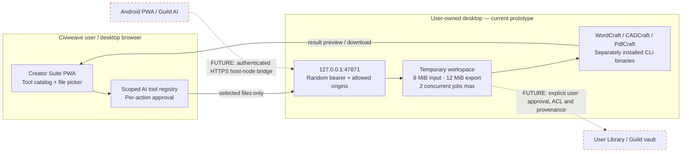
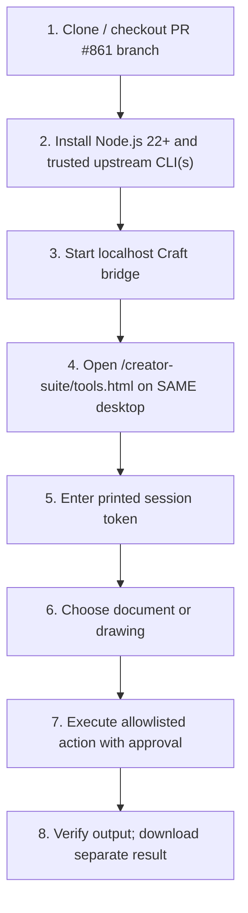
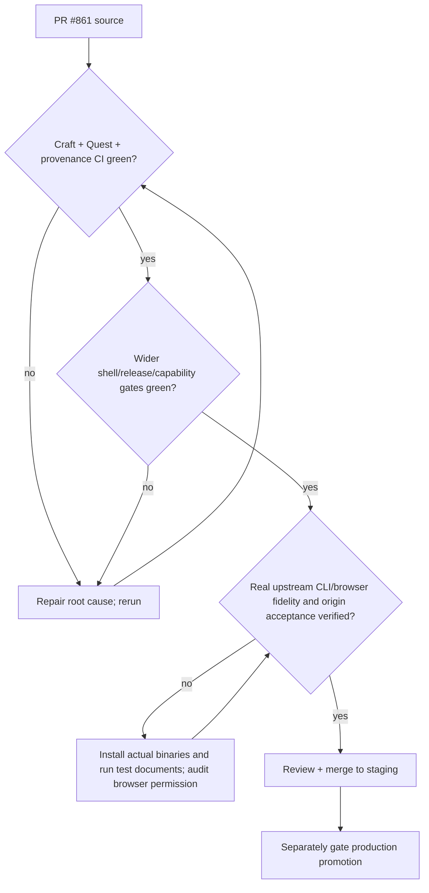

# Creator Suite: Visual implementation guide

**Scope:** 11 standalone Craft applications, five optional business services. The hosted ArtCraft AI service is intentionally excluded. This is a visual implementation map, not a declaration that every listed application is installed or connected.

## Architecture



## Current execution matrix

| Tool | Implemented, CLI required | Not yet implemented |
|---|---|---|
| WordCraft | Inspect selected DOCX/ODT/RTF/Markdown/TXT, extract text, new PDF export | In-browser editing, full fidelity |
| CADCraft | Selected DXF/DWG info and SVG export | Full in-browser CAD |
| PdfCraft | One-PDF info/text; combine two PDFs into new file | OCR, signatures, annotations |
| Other eight Craft tools | Catalog only | Executable adapters |
| Gotenberg, Paperless-ngx, Stirling PDF, Collabora, Documenso | Listed as optional service candidates | Service deployment and authenticated connectors |

## Tested desktop setup



PowerShell:
```powershell
$env:CIVWEAVE_CRAFT_ALLOWED_ORIGINS='https://civweave-staging.pages.dev'
node tools/creator-craft-bridge/server.mjs
```

Official upstream releases: [WordCraft](https://github.com/storytold/wordcraft/releases/latest), [CADCraft](https://github.com/storytold/cadcraft/releases/latest), [PdfCraft](https://github.com/storytold/pdfcraft/releases/latest).

**Security warning:** Loopback on an Android phone is the phone itself. This is *not* currently a phone-to-PC host-node link. Do not forward port 47871 or add a public tunnel to this bridge.

## Release decision



See also [Craft + Business Integration Contract](CRAFT-BUSINESS-TOOLS-v1.md) and [local bridge setup](../tools/creator-craft-bridge/README.md).
