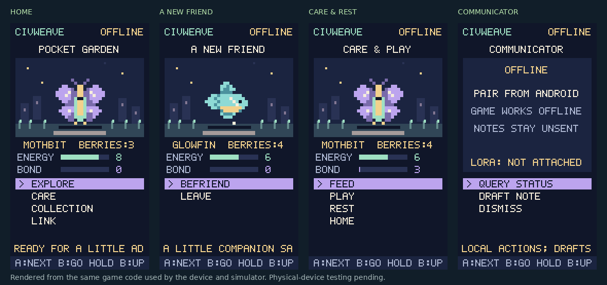

# Civweave Pocket Companion — Thread 5

An offline creature game and communicator display for **M5StickS3 / UIFlow2**.
The same Python game and pixel renderer run on the device and in the desktop
simulator. This is an optional UIFlow2 collection-game experiment, with
physical-device validation still pending.



## Try it on Windows now

With Python 3.10 or later installed, open this directory and double-click
`start-pocket.cmd`, or run:

```powershell
py simulator.py --open
```

On macOS or Linux:

```bash
python3 simulator.py --open
```

The simulator serves only `http://127.0.0.1:8768`. It needs no Python packages,
cloud account, device, or internet connection. Keep the terminal open while
playing. Closing the browser is safe; Ctrl+C in the terminal stops the server.
Progress lives in `.pocket-state/` beside the simulator, excluded from Git.
Opening `simulator.html` directly is insufficient: its Python server runs the
game. The connection lab supplies explicitly simulated BLE reports; it sends
no real messages and contacts no phone.

## Controls and game

| Control | Action |
| --- | --- |
| A | Next option |
| B | Choose highlighted option |
| Hold B for 650 ms | Return home; does not also select |
| Desktop A / right arrow | Next option |
| Desktop Enter / B / Space | Choose |
| Desktop Escape | Home |

Start with **Mothbit**. Walk the trail to encounter **Glowfin**, **Pebblehop**,
and **Breezelet**. Befriend them, switch your active companion, share berries,
play, or rest. Rest is free and restores energy. Absence has no penalties.
Game berries and bond are local play values, with no Civweave credits, Quest
proof, real-money value, or shared-world authority.

The device coalesces progress saves after five seconds, independent of screen
redraws. Wait at least six seconds after an action before switching off. Two
bounded, checksummed files retain the previous valid save when the newest
record is damaged. Host tests simulate corrupt and partial writes; actual
flash power-cut behavior has not been tested. A save failure displays
`SAVE FAILED - RAM ONLY` while play remains available.

## Try on an existing UIFlow2 StickS3

This source targets the StickS3's **135 × 240 portrait display** and BtnA/BtnB.
The entrypoint checks display dimensions before running. It is an app, not a
firmware image. Actual button timing, display speed, storage, and BLE pairing
still need a physical device test.

1. Connect the existing StickS3 in UIFlow2 WebTerminal.
2. Open **File**, navigate to **`/flash/libs`**, and use **Send File to Here** for
   `pocket_game.py`, `pocket_save.py`, `pocket_link.py`, `pocket_view.py`, and
   `sticks3_main.py`. UIFlow2 adds this directory to its import path.
3. In Python Custom Edit, use this short launcher and **Run Once**:

   ```python
   import sticks3_main
   sticks3_main.main()
   ```

4. Check A, B, hold B, exploration, rest, and save/restart. Check the terminal
   if the display reports an error. The source does not change `boot.py` or
   `main.py`; keep this as a trial before choosing a startup application.

An alternative USB trial uses the official `mpremote` tool. Close WebTerminal's
serial connection first. **COM7 below is an example; select the actual port
from `connect list`.**

```powershell
py -m pip install mpremote
mpremote connect list
mpremote connect COM7 fs cp pocket_game.py pocket_save.py pocket_link.py pocket_view.py sticks3_main.py :/flash/libs/
mpremote connect COM7 run sticks3_main.py
```

`mpremote run` temporarily interrupts the current app and executes the supplied
entrypoint in RAM without replacing the device's existing `main.py`. Rebooting
returns to the configured startup application. Device progress uses
`civweave-pocket-save.0` and `.1` in UIFlow2's `/flash` working directory.

## What the communicator can do in this slice

- Advertise the existing `Civweave-Pocket` BLE service when `m5ble` is present.
- Receive and display legacy framed `S` status records from the phone bridge.
- Send explicit `Q` (query) and `X` (dismiss) button notifications to that bridge.
- Emit a bounded **local, unsent** quick-note intent for a future phone adapter.
- Distinguish offline, phone-linked, recent phone report, and stale report.

This slice does not implement person-to-person message delivery, microphone
capture, speech playback, a phone app, radio drivers, encryption, or AI inference.
The existing Android bridge work is [draft PR #911](https://github.com/cerbanimo-dev/Civweave/pull/911).
It remains responsible for phone connection/background-service work; its APK
and end-to-end pairing need validation. This is an optional manual game trial,
not a replacement shipped over the v0.5 device monitor. Run one device app at
a time. Before a combined release, the integration thread must choose one
device entrypoint and preserve any desired v0.5 image/audio behavior there.

### Relationship to Thread 9 Pocket Commons

Staging also contains [Thread 9's Pocket Commons firmware](https://github.com/cerbanimo-dev/Civweave/tree/staging/native/sticks3-communicator)
and its [browser lab](https://github.com/cerbanimo-dev/Civweave/tree/staging/public/labs/pocket-commons).
That is a separate Arduino/PlatformIO firmware target with
the Threadling game and `CW` carrier framing. This directory supplies the
optional UIFlow2 collection game and legacy phone-status experiment; the two
are not integrated.

The runtimes, controls, save formats, and transport frames differ; no conversion
between the prototypes is implemented. Thread 9's PlatformIO upload replaces
the running firmware. Its compiled firmware does not run these Python files,
and this app does not parse its carrier frames. Run this trial only on a device
already using UIFlow2.
For a combined release, choose one runtime and device entrypoint, then port
the desired game/display behavior and connect the transport through that
owner. Keep Thread 9's carrier protocol and the existing private-messaging
authority intact.

The browser simulator never opens Bluetooth. Device BLE pairing and backend
trust are not proven by desktop tests. Nine seconds of freshness means time
since the phone supplied a valid frame; the Stick does not verify server
signatures or prevent an authorized/unauthenticated peer from replaying an
old frame. The visible label is **phone reported**, not backend verified.

## Transport handoff for the other threads

Thread 5 owns this optional UIFlow2 collection-game experiment and its tiny
display. Thread 9's standalone firmware and carrier work remains in
`native/sticks3-communicator/`. Private messaging stays with
`public/app/civweave-private-messaging-v1.js` and object synchronization with
`public/app/local-object-mesh-v146.js`. The existing PWA chat, identity,
encryption, and Guild authorities are unchanged.

| Boundary | Contract |
| --- | --- |
| Game input | `Game.input('next' | 'select' | 'back')` returns explicit intents |
| Note | `{'type':'note_draft','text':'Hello from my pocket companion.'}`; local/unsent |
| BLE service | `bc257ca0-197e-4ba4-8ab7-c70ef45c0010` |
| Phone writes | RX `bc257ca0-197e-4ba4-8ab7-c70ef45c0011` |
| Device notifies | TX `bc257ca0-197e-4ba4-8ab7-c70ef45c0012` |
| State frame | Start `01 S <u16 length BE> <u16 sum BE>`; data `02 <1..19 bytes>`; end `03` |
| Status ACK | `K1` accepted, `K0` rejected; this is not a message-delivery receipt |
| Explicit clear | `04` clears the report and partial frame |
| Bounds | 768-byte state, 3-second frame assembly limit, 9-second report display TTL |

Example status record, supplied by a phone after its own upstream checks:

```json
{"schema":"civweave.pocket.state.v1","source":"server","fresh":true,"mode":"idle","agent":"moss","task":"Ready"}
```

Accepted agents are the canonical five guides; accepted modes are `idle`,
`generating`, `completed`, `blocked`, and `needs_human`. The checksum detects
accidental framing damage; it provides no authentication. Unsupported JPEG
`I` transfers and manual art-preview packets are declined with `K0` because
this app draws its own game. A v0.5 phone client must handle this refusal;
this app does not claim full v0.5 wire-feature equivalence.

### LoRa comes later

No LoRa module is selected or purchased by this work. The UI and game have no
radio dependency, so hardware choice can wait. When a transport thread adds a
radio, it should adapt authorized phone/canonical-message events to a reviewed
display contract. Keep radio packet size, retry policy, identity verification,
and delivery receipts in that transport owner. Do not equate BLE `K1`, a
local draft, a radio transmit callback, or a fresh status report with delivery
to another person. The original game should remain playable with radio off.

## Verification

From the repository root:

```bash
python3 -m unittest discover -s native/sticks3/tests -v
python3 -m compileall -q native/sticks3
```

The 51 host tests cover offline play, resource recovery, menu controls, save
corruption and partial writes, BLE bounds and TTL, clock rollover, pixel
bounds, whole-device loop stubs, simulator endpoints and loopback restrictions.
The browser script passes Node syntax checking. Native screen commands were
rendered and visually inspected. Automated interactive browser testing was
blocked by this execution environment's browser process restrictions; the
separate browser service could not reach its loopback server. Physical device,
Android pairing, power-cut recovery, and LoRa tests remain outstanding.

## Sources and compatibility

- [Official StickS3 hardware](https://docs.m5stack.com/en/core/StickS3)
- [Official UIFlow2 StickS3 examples](https://uiflow-micropython.readthedocs.io/en/stable/controllers/sticks3.html)
- [Official UIFlow2 file manager](https://docs.m5stack.com/en/uiflow2/projects/file_manager)
- [UIFlow2 boot/import path](https://github.com/m5stack/uiflow-micropython/blob/master/m5stack/modules/_boot.py)
- [Official MicroPython mpremote](https://docs.micropython.org/en/latest/reference/mpremote.html)

The pixel renderer uses its own bitmap font because current UIFlow2 builds
can map old tiny-font aliases to larger proportional fonts.
